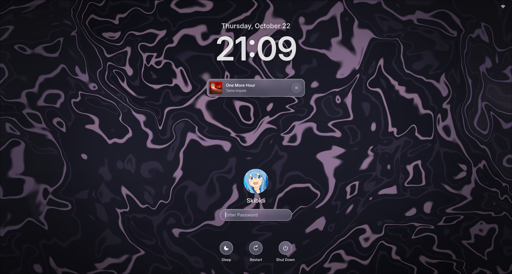

# roselock
A (cool) macOS inspired lockscreen.


## requirements

- **linux + wayland** — roselock is intended for wayland desktops.
- **[quickshell](https://github.com/quickshell-mirror/quickshell)** — required to run roselock.
- **a compatible wayland compositor** — required for wayland layer surfaces.
- **coreutils** — used by the installer for file operations.
- **grim** — for screenshot blur.

some components may require additional system utilities or services, depending on how they are implemented. make sure any tools used by your configuration are installed and available in your `PATH`.

## installation

clone the repository and run the installer:

```bash
git clone https://github.com/sappyware/roselock.git
cd roselock
chmod +x install.sh
./install.sh
```

the installer copies the QML files into `~/.config/quickshell/roselock/`.

## running

start roselock with:

```bash
qs -c roselock
```

to stop it, use:

```bash
qs -c roselock kill
```

## configuration
```bash
# roselock config — hot-reloaded on save

[wallpaper]
# "screenshot_blur" | "file" | "shader"
mode = "screenshot_blur"
# empty = $XDG_RUNTIME_DIR/roselock-desktop.png
screenshot_path = ""
# 0.0 sharp → 1.0 heavy wash
screenshot_blur = 0.6
# 0.0 flat tint → 1.0 full frost
glass_blur = 1.0
# shader basename from ~/.config/rosewallpapers/shaders/
shader = "topo"
# 24 / 30 / 60
shader_fps = 30
# absolute path, only used when mode = "file"
file = ""

[ui]
# false = 12h, true = 24h
use24h = false
# 0.0 none → 0.6 near-black
dim = 0.14
show_wifi = true
show_battery_percent = false
# "" = auto-detect Inter
user_family = ""
# "" = capitalised $USER
display_name = ""

[transition]
# "screenshot" (safe) | "live" (seamless, hyprland)
mode = "screenshot"
# ms
fade_ms = 700
```
## ⚠️ You need [rosewallpapers](https://github.com/sappyware/rosewallpapers) for shader mode.
## help me fix any bugs with PRs!
